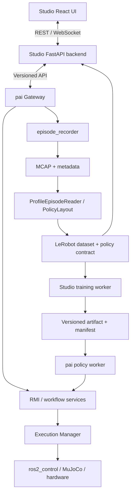

# 执行计划：用 pai 替换 Physical AI Studio 的机器人运行层

> 本文可直接下发给本地 coding agent。目标是交付可运行的集成产品，而不是只完成接口设计或 UI mock。
>
> 已确认决策：Gabriel-Ning/pai 是唯一机器人运行核心；Physical AI Studio 提供 Web 工作台。舍弃 Studio 原有机器人运行路径，不维护两个机器人运行后端。
>
> P0 已在本机完成。进度与证据在 [docs/integration/implementation-status.md](docs/integration/implementation-status.md)，基线在 [docs/integration/baseline.md](docs/integration/baseline.md)，已接受的拓扑和产物格式在 [docs/integration/adr/0001-runtime-topology.md](docs/integration/adr/0001-runtime-topology.md)。这些文档不替代本文的 P1–P6。

## 1. 任务定义与执行原则

你是本地实施 agent。请先阅读本地两个仓库的 AGENTS.md、开发文档和当前代码，再按本文阶段顺序实施。本文允许为集成修改应用代码、测试、依赖声明、数据库迁移与锁文件；此前云环境 onboarding 的“不得修改源码”仅约束 onboarding，不适用于这个 coding 任务。

必须遵守以下要求：

1. 先检查 `git status`，保留用户已有修改和未跟踪文件，不执行破坏性 reset，不覆盖本地配置和凭据。
2. 本文中的新增路径、类名、API 是设计建议，不是现存接口。按实际仓库组织调整，并在 implementation log 中记录对应关系。
3. 不把文档描述当作已实现能力；必须追踪代码、调用方和测试。遇到缺失能力，实施或明确记录阻塞。
4. 使用当前仓库实际版本。若与下方基线不同，先记录差异，不为了匹配本文而强行回退。
5. 使用已有 checkout。仅在本地工作规范要求或用户指定时使用 worktree。
6. 本地开发默认仿真。真机测试必须有现场操作者明确授权、设备清单与安全条件；其他开发任务继续推进。
7. 不询问已明确的架构方向。对非关键实现细节自行作出合理决定并记录；只有缺失凭据、硬件、安全条件或无法推断的产品要求才请求用户输入。
8. 每个阶段交付代码、测试和运行证据。不能把“下一步可执行”当作已完成。
9. 不为通过测试跳过校验、禁用失败断言、伪造设备状态或把 zero-test run 视作通过。
10. 不自动 push、merge 或发布到生产。完成可审查的本地提交或变更集。

## 2. 已检查的版本与事实

规划起草时的提交：

- pai：`7e2a177e9622c9a592a79e5744310cbdf59789bf`。
- physical-ai-studio：`e9fb4a448c78b9a9a6d379aac70d1d7548e1f4f5`。
- 仓库 URL：`https://github.com/Gabriel-Ning/pai`、`https://github.com/open-edge-platform/physical-ai-studio`。

2026-10-12 本机复核：Studio 仍是上述提交。pai 在 `dev-v4`，HEAD 为 `b3175f595465f7f254c99d5adc792e579e12fdea`，工作区另有未提交修改。按实际 HEAD 继续，不回退到起草提交。

已确认：

- pai 使用 Pixi、ROS 2 Jazzy、Python 3.12。环境是 `default`、`cuda13`、`lerobot`。没有 `robomimic` 环境。
- pai RMI 是应用入口；Execution Manager 是控制资源权限与动作路由的权威层。
- pai 应用是 `teleop`、`record`、`replay`、`eval`、`eval_task`、`convert_lerobot`、`check_runtime`。推理在 `src/policy_inference/lerobot/`，由 `eval.py` 调用。没有 local/cloud/robomimic 推理应用。`record` 与 Piper `teleop` 仍用终端按键组织流程。
- episode_recorder 录制 MCAP；dataset_tools 转换为 LeRobot 数据集，PolicyLayout 定义语义布局，输出包含 policy_contract.json。
- pai orchestrator/server.py 是 transport adapter 可调用的 handler 类，不是现成 FastAPI HTTP 服务；orchestrator 包当前存在 COLCON_IGNORE。
- Studio 有独立 FastAPI 后端与 React UI；其机器人运行基于另一套 `physicalai` 包的 RobotRuntime、SharedRobot、SharedCamera，以及 Zenoh/iceoryx2。
- Studio catalog plugin 主要用于 Python driver/catalog/schema 扩展，不能单靠插件替换所有 session、recording、camera、deployment 路径。
- Studio 后端基线 Python 要求 `>=3.12,<3.14`；UI package.json 要求 Node `>=24.2.0`、npm `>=11.14.0`。本地以实际 version pins 为准。
- Studio 训练与模型导出可能继续依赖 `physicalai` 配置/推理工具；删除机器人运行层不等于可以直接删除整个依赖包。

云环境曾只完成源码检查，pai default 安装被 prefix.dev 网络阻塞。2026-10-12 本机已有 `default` 与 `lerobot` 环境、colcon overlay、无头仿真和数据集转换的运行证据，见 `docs/integration/baseline.md`。本机没有可用 NVIDIA 驱动，训练仍未执行。

## 3. 最终产品边界

| 层 | 必须负责 | 不应负责 |
|---|---|---|
| Studio UI | 项目、环境/profile 选择、机器人状态、相机、采集操作、数据集、训练、模型、部署、评测展示 | 控制循环、直接 DDS、直接设备 I/O |
| Studio backend | 用户/project 权限、持久化、数据集/模型管理、训练编排、Gateway client、WebSocket relay | 打开机器人/相机设备、维护第二套动作权限 |
| pai Gateway | 会话与生命周期、能力发现、RMI 调用、状态事件、任务管理、录制/部署/评测入口 | 替代 EM 裁决、硬编码机器人逻辑、把 HTTP 放进实时循环 |
| pai RMI/EM/ROS | profile 语义、执行资源、teleop/policy/memory、控制器、仿真/真机、故障恢复 | Studio 数据库、Web 页面 |
| 训练 worker | 模型训练与导出、进度与产物 | 真机控制、实时控制循环 |



首个部署为同机、分进程、共享受控 artifact 根目录。随后支持 Studio server、ROS workstation、RT host、GPU worker 分机部署。Gateway 部署在 ROS workstation，RT 控制循环留在既有 RT host。

最终只启用 pai 机器人运行路径。旧路径可在迁移中暂留供对照，但不得再打开设备；最终删除旧模块及其专属依赖，不能留下 UI 可切换的 native/pai 双后端。

## 4. 范围与首个纵向闭环

完整交付范围：仿真/真机接入、采集、数据集可视化、训练、仿真/真机策略部署、回放、评测、运行状态与故障恢复。

首个可验收闭环：

```text
创建项目 → 选择 pai profile → 连接仿真 → 查看状态/相机
→ 演示采集 → 保存 episode → 转换数据集 → Studio 查看数据
→ 小规模训练 → 注册模型 → 契约检查 → 仿真部署 → 评测结果
```

第一条组合已经锁定，见 ADR 0001：profile `fr3_pika_single_arm`，MuJoCo headless，`JointPolicy` 的 8 维关节位置。产物是 LeRobot ACT pretrained 目录加 `policy_contract.json`。Studio 原生 `physicalai.policies.act` checkpoint 不能直接交给 pai `LeRobotPolicy`。训练走 Studio 已有的 `policy_source=lerobot`，或由 Studio 调度 pai 的 `lerobot` 环境。

不要因为缺少 GPU、LIBERO/RoboTwin 任务资产或某台真机而阻塞只读与采集开发。仿真 smoke 使用仓库已有、无需外部大型资产的场景；如果没有，则新增一个明确版本化的最小测试场景，不伪造 full benchmark readiness。

## 5. 代码入口与改造清单

### 5.1 pai

必读：

- `README.md`、`pixi.toml`、`pixi.lock`、`scripts/setup.sh`。
- `src/interfaces/rmi/rmi/{config,context,robot,node,selection,contracts,recording,replay,reset,sensing}.py`。
- `src/execution/execution_manager/README.md` 和 `docs/ARCHITECTURE.md`。
- `src/execution/orchestrator/orchestrator/{server,runtime,registry}.py` 及其测试。
- `apps/README.md`、`apps/profiles/`、`apps/recording/`。
- `apps/record.py`、`apps/replay.py`、`apps/convert_lerobot.py`、推理与评测入口及共享模块。
- `src/toolbox/dataset_tools/README.md`、recording 和 policy_inference 文档。
- 实际选定机器人 bringup launch、默认 DDS 配置。

建议新增一个 `pai_gateway` 包，以及可测试的 application/workflow services。按仓库约定决定是 ROS ament_python 包还是独立 Python 包；记录 ADR。业务操作由库级服务实现，CLI 与 HTTP 共用，禁止 Web 模拟 ENTER/SPACE 键。

Gateway HTTP 依赖应有正式 manifest/lock 管理。优先保持 ROS prefix ABI：可以在 default feature 添加必要且兼容的 Web 依赖，或 HTTP frontend 与 ROS worker 分进程通信。不要直接 pip install 改坏 conda prefix；不要安装全部 CUDA 依赖仅为得到 FastAPI。

### 5.2 Studio backend

必查：

- `application/backend/src/api/runtime_sessions.py`、`api/runtime_ws.py`。
- `runtime/contract.py`、`runtime/session.py`、`runtime/owner.py`、`runtime/features.py`、`runtime/config_builder.py`。
- `services/runtime_session_service.py`、robot catalog service 与构造调用链。
- `services/dataset_import/adapters/lerobot_v3.py` 和 dataset service/repository/migrations。
- `services/training_backends/`、training workers、model import/export/deployment 路径。
- `tests/runtime/`、`tests/api/test_runtime_ws.py`、session tests、dataset import tests、training tests。

新增 Gateway client、运行服务与错误映射。优先复用现有路由/前端事件含义；语义不一致时修改 schema，不强行返回假状态。原 session list/count/stop 当前基于本机 lock/PID：全部改为 Gateway 的 session registry，禁止按远程 PID 在 Studio 主机 kill 进程。

### 5.3 Studio UI

先阅读 `application/ui/AGENTS.md`。复用项目、数据集、训练和模型页面；运行页改为 pai profile、资源权限、任务、录制、仿真/真实环境与 Gateway 状态。

后端 API 变更后重新生成 OpenAPI 类型，不手改 generated 类型来掩盖 schema 问题。保留 camera UUID 与模型 feature key 的显式映射；它们不是同一个标识。

## 6. 契约设计

### 6.1 Gateway API v1

以下是拟议接口。阶段 1 冻结成 OpenAPI 与 JSON Schema，所有本地 clients 使用同一契约。

| Method | Path | 语义 |
|---|---|---|
| GET | `/v1/health/live` | 进程存活，不等于 ROS 或机器人 ready |
| GET | `/v1/health/ready` | 服务依赖与 ROS 可用性；按 capability 给出状态 |
| GET | `/v1/capabilities` | API/runtime/version、机器人、动作、录制、训练/部署支持 |
| GET | `/v1/profiles` | 受管理 profile 列表与摘要 |
| POST | `/v1/sessions` | 创建或附着 session，明确 observe/control 模式 |
| GET | `/v1/sessions` | 跨 Studio 重启的会话清单 |
| GET | `/v1/sessions/{id}` | 完整状态快照 |
| POST | `/v1/sessions/{id}/commands` | 类型化命令及确认；禁止任意 shell |
| DELETE | `/v1/sessions/{id}` | 幂等 teardown，不删除项目或原始数据 |
| GET | `/v1/sessions/{id}/events` | WebSocket：snapshot、state、ownership、ack、error、job |
| GET | `/v1/sessions/{id}/cameras/{camera_id}/preview` | 独立限速预览；MVP 可用 MJPEG |
| POST | `/v1/episodes` | prepare，绑定 session/profile/task/recording contract |
| POST | `/v1/episodes/{id}/commands` | start/stop/save/discard |
| GET | `/v1/episodes/{id}` | 状态、finalization、原始 artifact、质量报告 |
| POST | `/v1/jobs` | 受支持 convert/evaluate 等作业；类型化参数 |
| GET | `/v1/jobs/{id}` | 进度、日志引用、结果、错误 |
| POST | `/v1/jobs/{id}/cancel` | 取消并报告实际取消结果 |
| POST | `/v1/deployments/preflight` | 只检查 artifact/profile/action contract，不激活机器人 |
| POST | `/v1/deployments` | 注册/准备部署，激活用单独 command |
| GET | `/v1/artifacts/{id}` | 受授权 artifact metadata/download，禁止任意路径读取 |

原则：

- 写请求有 `request_id`，session/profile/project/artifact 都使用 ID；不接收任意本地绝对路径、shell 命令或未验证 ROS 参数。
- 非幂等边缘操作 save/discard 必须持久化 dedup 结果；同 ID 同 body 重试返回相同结果，同 ID 不同 body 返回 conflict。
- 长任务返回 `202 + job_id`；状态区分 accepted/requested/running/succeeded/failed/cancelled。模型 loaded 不等于 policy active。
- 错误结构包含 `code/message/request_id/retryable/details`；details 只包含可安全展示的数据，不泄露凭据。
- 事件包含 schema_version、session_id、event_id、sequence、wall timestamp；机器人数据另含 ROS timestamp 与 clock domain。
- 重连先给完整 snapshot，再给增量；序号缺口触发 snapshot refresh。不要把 best-effort telemetry 当可靠命令确认通道。
- REST OpenAPI 与 WebSocket JSON Schema 一并版本化；不兼容主版本明确拒绝，附带所需升级信息。

### 6.2 Session 与 ownership

Studio 用户权限、Gateway session 控制权和 EM resource lease 是三个不同层级，不能互相替代。

Session identity 至少包含 robot identity、backend(sim/real)、resolved profile digest、resource scope。相同 identity 可以附着观察；控制客户端需要明确 ownership。不同 identity 争用同一资源返回 busy/conflict，不隐式抢占。

EM 是唯一动作权限裁决者。Gateway 不维护能绕过 EM 的 shadow lease。向 Web 推送 source role、requested/active/faulted、owner、resource、reason 与可恢复状态；不要把 candidate registration 映射成已经拥有控制权。

断开网页、Studio 崩溃、Gateway 崩溃、DDS 丢失、policy 超时分别制定行为。任何连接丢失后的新 attach 默认 observe/idle，不自动恢复先前策略执行。应用心跳频率与超时必须基于现有 EM/RMI 实际实现设定，不复用 Studio 原生 45 秒 idle timeout。超时后执行 source stop/release；实际 hold/deactivate 行为按 controller/robot 能力确定，不能通用假设断电安全。

Gateway 自身恢复后重新查询 ROS 状态；无法确认的 session 标记 unknown/reconciliation_required，不使用数据库旧状态证明控制器已停止。

### 6.3 录制状态机

```text
prepared → recording → stopped → finalizing → saved → converting → ready
                       └→ discarding → discarded
任一步失败 → failed/recovery_required（保留可恢复 artifacts 与原因）
```

原始 episode 与 dataset conversion job 分开。stop 只是停止采集；save ack 表示请求已接受/持久化，只有 finalization 成功才 saved；只有验证后的数据集被导入 Studio 才 ready。

禁止转换中删除原始 MCAP。discard 只影响当前未发布 episode，已被 dataset/model 引用的原始数据需明确 retention 流程。重复 save、浏览器重连、Studio 重启不得生成重复 episode。录制中禁止改 profile/相机布局/控制契约。

### 6.4 数据与模型

MCAP 是原始事实源，LeRobot 是派生训练数据。唯一转换路径复用 pai ProfileEpisodeReader/PolicyLayout，禁止 Studio 同时录制第二份不同语义 dataset。

必须保留：profile 快照与 digest、关节/part 顺序、状态/动作切片、动作表示与单位、坐标系、相机 keys/UUID 映射、图像 RGB/尺寸、采样频率、时间域、normalization、转换版本、source episode IDs、校验摘要与 policy_contract.json。

按实际 LeRobot metadata 验证版本，不能因为都叫 LeRobotDataset 就断言兼容 Studio 的 v3 importer。若 pai 输出版本不兼容，添加显式转换适配和 fixture 测试，不改写原数据伪装版本。

模型 manifest 至少包含：model_id、dataset/version、training config、checkpoint/export format、loader kind、policy type、observation/action contract、processors/normalization、required device/runtime、artifact digests、相关代码版本与训练结果。

部署 preflight 验证完整语义。只校验维度不合格。`force` 不得跳过关节顺序、单位或硬件契约校验。失败必须在 UI 给出具体差异。

## 7. 分阶段实施任务

### P0 — 基线、环境与兼容性 spike

状态：done（2026-10-12）。交付物在 `docs/integration/`。下面保留当时的执行要求，供对照。

执行：

1. 检查本地 checkout、branch、HEAD、修改、submodules、AGENTS 和硬件资源；创建 baseline report。
2. 按仓库锁文件安装 pai default 与 Studio CPU backend/UI。训练 CUDA 环境只在 GPU 任务需要时安装。
3. 启动一个 pai 无头仿真；检查 joint_states、controller 状态、camera（若支持）与实际 RMI observation。
4. 完成一条现有 MCAP 样本转换，导入 Studio，核对视频、state/action、episode 长度与 metadata。
5. 做 checkpoint spike：选择一种算法，将真实可加载的最小 artifact 输入 pai loader 或拟议 policy adapter，执行 dummy/短 episode 并验证输出契约。
6. 扫描 Studio 所有 physicalai、Zenoh、iceoryx2、RobotRuntime、SharedRobot、SharedCamera 引用，区分机器人运行专属与训练/导出共享用途。

交付：`docs/integration/baseline.md`、`dependency-map.md`、ADR（拓扑、包组织、首个机器人/算法/模型格式）、smoke fixtures。实际路径按项目文档约定调整。

完成条件：明确能运行的仿真 profile、dataset compatibility 和 policy loading 方案。失败项归因并有纠正步骤；不能只产生报告后停止。

### P1 — Gateway 基础与契约

执行：

1. 实现配置加载、受管理 profile registry、version/capabilities/health、日志与 correlation IDs。
2. 实现 Gateway 包与入口，严格分离 HTTP handlers、workflow services、RMI/ROS adapter。
3. 实现 session registry、类型化 command、ack、事件快照和重连；保存需要跨重启恢复的 metadata/dedup/job 状态。
4. 实现只读观察链路与资源归属查询。ROS adapter 负责 executor/thread 生命周期，HTTP async loop 不阻塞等待 ROS future。
5. 实现 profile allowlist、路径约束、认证配置与 project scope；localhost 单人 dev 模式显式标注，非 loopback 默认必须认证。
6. 对未知 ROS 状态、超时、unsupported command 返回明确错误。

验收：健康检查区分 live/ready；ROS 不在线时不可假 ready；WebSocket 重连获得正确 snapshot；真实 ROS 状态可读；非法 profile/path 被拒绝。

### P2 — Studio 运行层替换与只读 UI

执行：

1. 新增 Gateway connection settings 与 client；凭据只留后端安全配置，不进入浏览器 bundle 或项目导出。
2. 数据库迁移增加 gateway/profile identity、backend、resolved contract digest、camera mapping；旧项目需要重新绑定 profile，不能自动对应到真实机器人。
3. 重写 runtime session service 与 API/WS 调用链，去掉 native session spawn、Zenoh owner attach、本机 PID kill。
4. 增加 Gateway down、ROS unavailable、robot busy、sim paused、unknown 状态的 UI。
5. 在 robot catalog 中展示 pai capabilities 和 profile forms。原 Studio serial/camera setup 控件对 pai 设备移除或替换。
6. 实现独立 camera preview；MVP MJPEG，限速/有界队列/丢帧，不能挤占控制和录制。
7. 更新 OpenAPI 与前端 generated types，确认项目/数据集/训练页面继续工作。

验收：浏览器连接仿真、读取关节/相机；刷新能附着；第二个客户端观察不抢占；Studio 进程无机器人/相机设备句柄；不存在 native 控制路径可被 API 启动。

### P3 — 采集与数据集闭环

执行：

1. 将 record CLI 中可复用业务流程提取为服务，CLI 和 Gateway 共用，保留已验证的 RMI/recorder 契约。
2. 实现 prepare/start/stop/save/discard 与持久化 state machine、dedup、finalization 恢复。
3. 将 teleop authority 与 recording gate 分开；开始录制不隐式取得机器人控制权。
4. 增加 conversion job，沿用既有同步规则与 processors，保存 metadata/contract/质量报告。
5. 实现 artifact staging/import：先校验、完成临时目录，再原子发布/注册 dataset。失败不得留下可被 UI 当 ready 的半成品。
6. UI 展示 episode 状态、任务标签、保存/丢弃、转换进度、错误与重试；复用 Studio dataset viewer。
7. 数据质量初期按已有实现展示；新增 missing streams、时间偏差、stale action 等 report，不虚构硬件同步精度。

验收：至少一条真实仿真采集 episode 可浏览；save 重试不重复；discard 不伤害其他 episode；转换失败可恢复；UI 刷新和 Studio 重启后状态一致；joint/action 数值与原始 MCAP 核对。

### P4 — 训练、模型与仿真部署

执行：

1. 根据 P0 ADR 实现一个训练 backend/adapter，复用 Studio job、日志、取消和模型管理。
2. 映射 dataset path/feature contract/task 与训练参数；验证超小数据集训练确实执行优化步骤，不只是初始化模型。
3. 注册 model manifest，保存 processors、normalization、dataset lineage 与 artifact hashes。
4. 实现 deploy preflight 与 loader/policy server adapter。推理 worker 与 Gateway/ROS control 进程隔离。
5. 策略动作通过 RMI POLICY source 与 EM lease 提交，禁止 Studio worker 直接调用 ros2_control。
6. 实现明确 activate/deactivate，加载模型不自动启动动作。策略崩溃/超时触发故障或释放，观测与动作时间约束可检查。
7. 映射 Studio hold/teleop/policy UI 到 pai 真实能力。hold 的语义按机器人确认，不能直接复制原 SharedRobot latched-target 逻辑。
8. 实现评测 job：reset、episode gate、最大时长、结果、人工/自动评分来源，绑定 model/profile/task seed。

验收：训练日志显示实际 steps 和产物；模型能加载；契约错配被阻止；仿真跑完短 episode；UI 展示正确评测结果；此 smoke 仅证明管线，不宣称模型学会任务。

### P5 — 回放、HIL 与真机接入

执行：

1. 使用 RMI MEMORY source 完成回放，明确 observed actions 与 executed commands 的差异。
2. 实现 teleop/policy/memory 状态与 EM preemption，UI 展示候选/拥有权/故障。
3. 增加真实后端启动确认：展示 robot/profile/resource/model 和现场控制条件；控制授权不能由网页自动 reconnect 触发。
4. 真机按现场 operator 批准的低速、低范围流程验证；硬件急停保持独立于 HTTP。
5. 测试网断、Gateway/Studio/policy 崩溃、DDS 异常、source lost、取消失败、恢复；不得自动调用 recovery 清除真实故障。
6. 验证双臂作为统一 robot/profile 的资源原子申请与部分抢占行为，不把独立 session 同时作用于同一机械臂。

验收：冲突客户端无法双重控制；物理 teleop 介入能按照 EM 规则抢占；动作超时/断网行为符合 ADR；恢复需要明确操作；真机未提供时此阶段标记 blocked，不能宣称全部完成。

### P6 — 移除旧层、部署与交付

执行：

1. 删除或替换 Studio RobotRuntime session、SharedRobot/SharedCamera ownership、StudioActionSource、native recording callbacks、robot process host 与专属 transport glue。
2. 对 Zenoh/iceoryx2/physicalai 依赖做 usage audit：仅在剩余训练/导出功能不需要时移除。不强制删除训练需要的通用组件。
3. 原 native tests 迁移为 Pai client/service tests；关键语义测试继续保留，不通过删测试掩盖功能损失。
4. 更新 migration、安装、启动、环境变量、profile、故障恢复与开发文档；移除失效 device/setup 说明。
5. 提供 dev 启动入口，以及可选 Studio/Gateway/worker 分机部署例子。ROS DDS network 明确配置，不能照搬普通 container NAT。
6. 不要求单容器塞入 GPU training、ROS、UI 和真机 RT kernel。
7. 干净环境复现安装/启动与端到端测试，验证 migrations 升级、旧项目重新绑定和失败恢复。

验收：全产品只存在 pai 机器人执行路径；项目/数据集/训练/模型流程正常；依赖/文档无悬空引用；所有完成声明有当前运行证据。

## 8. 测试矩阵

| 类型 | 必须覆盖 |
|---|---|
| Gateway unit | 状态机、dedup、同 ID 不同 body、输入验证、错误映射、timeout/cancel、profile digest |
| 契约 | OpenAPI/WS schema、client compatibility、未知版本、snapshot/reconnect/sequence gap |
| ROS integration | 实际 RMI observation、source lifecycle、EM ownership、ROS clock paused、source loss |
| 录制 | save/discard 重试、finalizer 失败、recovery、转换失败、不完整 artifact 不发布 |
| 数据 | 实际 MCAP→LeRobot fixture、RGB、关节顺序、causal action、metadata/version compatibility |
| 部署 | checkpoint load、normalization、错误关节/单位/相机键拒绝、policy crash、deactivate |
| Studio backend | session list/count/stop、权限、Gateway unavailable、DB migration、dataset/model lineage |
| UI | 连接、重连、busy/fault 状态、save pending、job progress、preflight failure、类型检查/build |
| 故障注入 | 浏览器/Studio/Gateway/policy 重启、网络中断、重复请求、部分数据、磁盘不足 |
| 真机 | 现场授权后独立记录，不能以 mock 结果替代 |

Fake Gateway 用于 Studio 隔离测试；真实 ROS smoke 用于验证集成，两者都需要。测试设备或 mock 必须明确标记。

每个测试记录：版本、命令、目标、实际计数、通过/失败/跳过、日志位置、产物。禁止把 skipped、expected-failure 或没有执行的命令描述成通过。

## 9. 安装与验证命令参考

以下命令来自规划基线；执行前核对本地锁文件、入口和测试依赖。路径变量应设为用户本地 checkout，不能假设本地为 /workspace。

```bash
# pai CPU
cd "$PAI_REPO"
pixi install --locked -e default
pixi run --frozen -e default setup

# Studio backend：核对 tests extra 和 uv.lock 后执行
cd "$STUDIO_REPO/application/backend"
uv sync --locked --extra cpu --extra tests

# Studio UI：若存在 package-lock.json，使用 npm ci
cd "$STUDIO_REPO/application/ui"
npm ci
npm run type-check
npm run build
```

pai build 应按代表性组件依赖图选择 `colcon build --packages-up-to ... --parallel-workers 2`，再执行相关 test/test-result；不要未经资源评估构建所有 GPU/设备组件。选包名必须来自实际 `colcon list`，本文不提供虚构名称。

现有 README 建议的 `scripts/franka_colcon_ignore.sh` 可用于 supported local build filtering；先检查标记和用户修改。不得直接启用缺失依赖的所有 ignored packages。

新 API 落地后从实际运行的 Studio backend 重新生成类型：

```bash
cd "$STUDIO_REPO/application/ui"
npm run build:api:download
npm run build:api
npm run type-check
npm run lint
npm run test:unit -- --run
npm run build
```

backend 与 Gateway 具体 pytest 路径由实施后的测试结构确定，写入最终 runbook。使用真实所选 sim launch `headless:=true` 等参数前检查该 launch 是否支持，不能盲目传参。

## 10. 运维、安全与恢复要求

- 同机 MVP：Studio backend 与 Gateway 分进程；artifact directories 分清 raw、datasets、models、jobs、staging。
- 分机：只允许认证的服务 API 与 artifact transfer 穿越边界。ROS DDS 留在 ROS 网络，不从浏览器或公网直接访问。
- 服务配置包含 Gateway URL、profile registry、artifact root、认证来源、超时与预览限速；真实名称由实现确定并写入 env example，不嵌入 secret。
- 磁盘不足在采集前检测，运行中失败保留明确 incomplete 状态；不能将缺帧/残缺 MCAP 静默发布。
- 进程 supervisor 只管理自己启动的进程组；attach 到既有 ROS 栈时 teardown 不杀用户的其他节点。
- launch 参数用 allowlisted typed models，不允许用户提交任意 executable/path/topic command。
- 用日志关联 browser request、session、episode、job、deployment；单独统计 ROS latency、preview drops、recorder health、policy timeouts。
- 数据库不存“机器人已停止”的永久断言；重启后与实际 ROS 状态对账。
- emergency stop 不依赖浏览器。软件 stop、source release、controller hold、硬件急停在 UI/文档中清楚区分。
- 模型回滚只在 inactive/安全确认状态切换 manifest/artifact，不能在动作执行中无缝替换未知契约。

## 11. 数据库与迁移

新增概念按现有 schema 归并，不为每个概念重复建表：Gateway connection、profile binding、session reference、episode provenance、job、deployment manifest。

迁移要求：

1. 保留既有 Studio project、dataset、model 数据和 IDs。
2. 旧机器人配置标记为 needs_pai_binding，不自动把 serial/IP 配置解释为可运行 profile。
3. 支持从原 schema 升级，migration 前备份用户数据库。
4. dataset/model lineage 可追溯到 source episode/profile contract。
5. 记录 API schema/runtime versions，不以机器 local path 作为跨主机 identity。
6. 不在 DB migration 中访问机器人或自动启动服务。

## 12. 变更组织与完成条件

建议按以下可审查变更集推进：

1. 基线/ADR/fixtures。
2. Gateway contract 与 ROS read-only adapter。
3. Studio runtime replacement 与 read-only UI。
4. Episode workflow、conversion 与 dataset import。
5. Training/model contract/policy deployment。
6. Replay/evaluation/HIL/real-device validation。
7. Legacy runtime removal、migration、部署文档与完整回归。

跨仓库契约变更必须记录对应 pai/Studio commits 和 API version。按各仓库提交规范执行；不要修改旧提交签名或强推来满足形式要求。

维护一份 `implementation-status.md`：每项 pending/in-progress/done/blocked、变更路径、测试结果、剩余问题和恢复命令。发现仓库事实与本文冲突时更新 ADR 和剩余计划，不能静默删掉训练、部署或真机目标。

最终交付必须包含：

- 两仓库可审查代码与锁文件变更。
- OpenAPI/WS schema、profile/model/data contract。
- 数据库迁移与备份/恢复说明。
- 已运行的仿真采集→数据浏览→训练→部署→评测闭环证据。
- 真机验收记录，或具体外部阻塞、已完成部分与剩余操作。
- 一份从安装到启动、测试、停止、故障恢复的 runbook。
- 原运行层删除清单与剩余共享依赖解释。
- 确认 Studio 不再直接控制设备，pai EM 为唯一执行权限裁决层。
